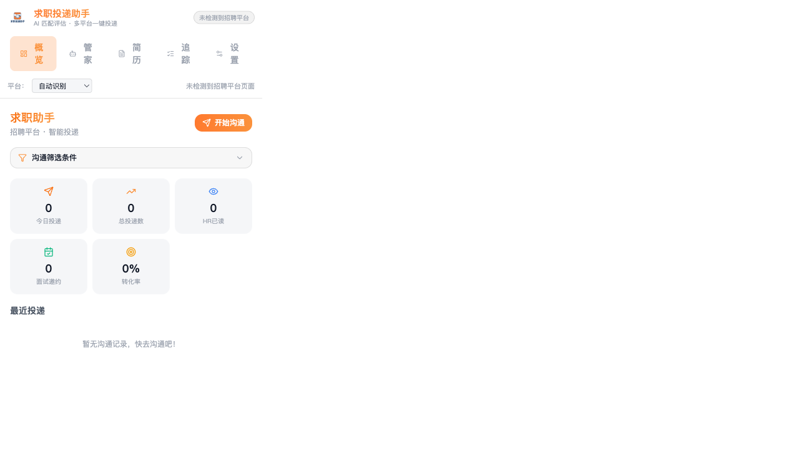
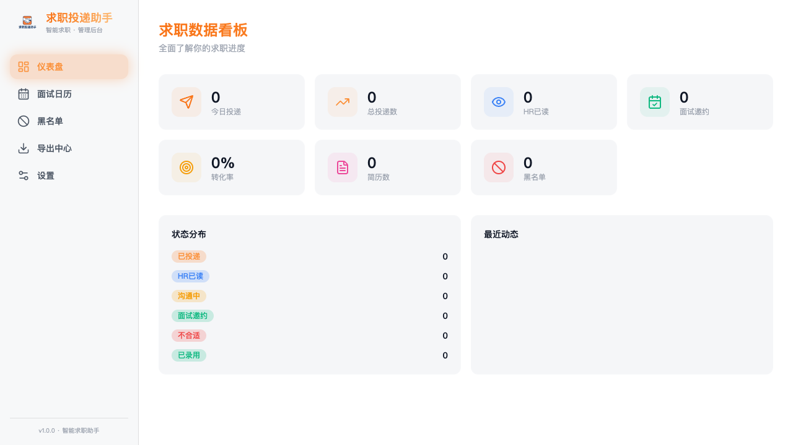
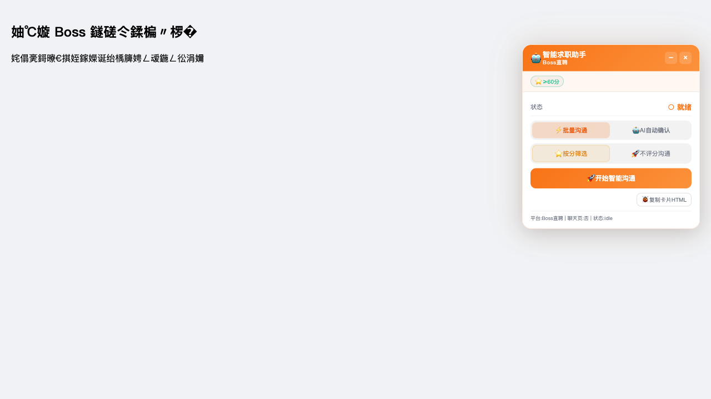

<p align="center">
  
</p>

<p align="center">
  <h1 align="center">🤝 智能求职助手</h1>
  <p align="center">
    多平台 AI 驱动的求职投递 Chrome 扩展 —— AI 匹配评估 · 管家 Agent · 一键投递 · 简历管理
  </p>
</p>

<p align="center">
  <a href="LICENSE"></a>
  <a href="https://github.com/cunzailv/qiuzhizhushou/stargazers"></a>
  <a href="https://github.com/cunzailv/qiuzhizhushou/issues"></a>
  
  
  
  
</p>

---

## 🎨 品牌与 Logo

以 **「握手」** 为核心图形语言：招聘平台与求职者、AI 与用户之间的双向连接。

- **主 Logo**：商务徽章式设计 —— 暖橙（`#FF7A2F`）× 深蓝（`#1E3A8A`）双色徽章，双手握手图形 + 品牌字标
- **浅色主题 UI**：全扩展（popup / options / 招聘页注入浮窗）统一为 **白底 · 黑字 · 橙色渐变 CTA**，与 Logo 徽章橙色形成品牌一致性

| 资产 | 用途 |
|------|------|
| `docs/assets/logo-transparent.png` | 透明底主 Logo（弹窗、设置页、README） |
| `public/icons/icon{16,48,128}.png` | 浏览器扩展图标（徽章图形） |

---

## ✨ 功能全景

项目按 **AI 能力 × 平台能力** 分四层演进，每层均通过功能测试 + 浏览器 E2E 验收：

### 🧠 A 层 · AI 匹配评估引擎
| 模块 | 说明 |
|------|------|
| **简历画像** | PDF / DOCX 简历 → 结构化画像（年限推断、项目提取、技能分级、亮点识别） |
| **JD 理解** | 岗位要求结构化（职责 / 硬性条件 / 加分项 / 技能分级 / 薪资学历年限） |
| **语义匹配评分** | 本地规则初筛 + 硬门槛拦截 + LLM 语义精评（0–100 分） |
| **差距报告** | 可解释的维度拆解（技能 / 经验 / 学历…）→ 差距 → 行动建议 + 简历改写要点 |

### 🤖 B 层 · 多角色求职管家 Agent
| 角色 | 职责 |
|------|------|
| **选岗 Agent** | 按画像与目标筛选值得投递的岗位 |
| **策略 Agent** | 生成沟通话术与投递策略（打招呼语 / 面试话术） |
| **沟通 Agent** | 执行批量沟通、按分筛选、不评分沟通等模式 |
| **跟进 Agent** | 投递后跟踪（已读 / 沟通中 / 邀约 / 黑名单） |
| **记忆留痕** | Agent 记忆持久化，跨会话记住求职偏好与历史决策 |

### 🛡️ C 层 · 基础设施与护栏
- 本地语义精筛（不消耗 token 先过滤低质岗位）
- 复盘 Agent（投递结果复盘，反哺策略）
- 流式思考展示（AI 决策过程可视化）
- AI 预算上限（每日 token 预算，防止超额）

### 🌐 D 层 · 多平台适配
| 平台 | 支持能力 |
|------|----------|
| **Boss 直聘** | ✅ 列表 / 详情 / 批量沟通 / 匹配徽章 |
| **猎聘** | ✅ 列表 / 详情 / 投递 |
| **前程无忧 51job** | ✅ 列表 / 详情 / 投递（2026-10 新增） |
| **智联招聘** | ✅ 列表 / 详情面板 / 投递（2026-10 新增） |
| **脉脉** | ✅ 列表 / 详情（保守策略 + 通用兜底） |

> 平台适配通过统一的 `PlatformAdapter` 接口注册，URL 匹配用裸域正则（`(?:^|[/.])domain`）防止跨站误匹配。

---

## 📸 界面预览（浅色主题）

| 弹窗（popup） | 管理后台（options） | 招聘页注入浮窗 |
|---|---|---|
|  |  |  |

---

## 🚀 快速开始

### 安装

```bash
git clone https://github.com/cunzailv/qiuzhizhushou.git
cd qiuzhizhushou
npm install
npm run build
```

### 加载扩展

1. 打开 `chrome://extensions/`
2. 开启「开发者模式」
3. 点击「加载已解压的扩展程序」
4. 选择项目的 `dist` 目录

### 使用流程

1. 点击扩展图标 → **简历** → 上传 PDF / DOCX 简历，设为默认
2. 打开任意支持平台（Boss 直聘 / 猎聘 / 51job / 智联 / 脉脉）的搜索或推荐页
3. 在 **概览** 设置沟通筛选条件（岗位 / 地点 / 薪资 / 学历 / 关键词排除）
4. 点击 **开始沟通**，右下角浮窗实时显示进度与 AI 匹配结果
5. 在 **追踪** 页查看投递漏斗（已投递 → HR 已读 → 沟通中 → 面试邀约）
6. 在 **管家** 页让 Agent 自动选岗、生成话术、复盘投递结果

---

## 🏗️ 技术栈

| 层 | 技术选型 |
|----|---------|
| 框架 | React 18 + TypeScript |
| 构建 | Vite 5 + crxjs（Manifest V3） |
| 样式 | Tailwind CSS 3 + shadow DOM 注入 |
| 数据 | Dexie (IndexedDB) + chrome.storage |
| AI | OpenAI / DeepSeek / 自定义兼容接口 + 本地语义精筛 |
| 测试 | Vitest（94 用例）+ Playwright（E2E） |
| UI 组件 | Lucide React + Recharts |

## 📁 项目结构

```
src/
├── background/         # Service Worker
├── content/            # Content Script（页面注入 + 浮窗）
├── popup/              # 弹窗 UI（浅色主题）
├── options/            # 管理后台（浅色主题）
├── components/ui/      # 共享 UI 组件
└── shared/
    ├── ai/             # AI 模型对接 & 匹配引擎（画像/JD/评分/精筛）
    ├── agent/          # 求职管家 Agent（选岗/策略/沟通/跟进/记忆）
    ├── antiBot/        # 防封 & 延迟引擎
    ├── db/             # 数据库 & 状态同步
    ├── export/         # 数据导出
    ├── parser/         # 简历解析
    ├── platform/       # 多平台适配（5 平台）
    │   ├── boss/       #   Boss 直聘
    │   ├── liepin/     #   猎聘
    │   ├── 51job/      #   前程无忧
    │   ├── zhaopin/    #   智联招聘
    │   └── maimai/     #   脉脉
    └── types/          # 全局类型定义
tests/                  # 94 个测试用例（含浏览器 E2E）
```

## 🔌 接入新平台

1. 在 `src/shared/platform/<name>/` 新建目录
2. 实现 `PlatformAdapter` 接口
3. 在 `src/shared/platform/index.ts` 注册适配器
4. 写测试并校准选择器，跑通 `npm test` 与浏览器 E2E

参考 `src/shared/platform/51job/` 的完整实现。

## 🧪 测试与验收

```bash
npm test        # tsc 类型检查 + 构建 + 全部 94 个测试用例
```

每个功能阶段（A/B/C/D/UI）都包含浏览器级 E2E 验收（加载 `dist` 扩展 → 真实页面注入 → 截图断言）。

## 📝 更新日志

| 版本 | 内容 |
|------|------|
| `8d4b343` / `7d255b1` | 🎨 全局浅色主题（白底黑字 + 橙色渐变 CTA），popup / options / 注入浮窗统一 |
| `4f58b0e` | 🎨 品牌 Logo（握手徽章）接入 + 全局品牌色统一 |
| `d1e3d22` | 🌐 D 层：51job / 智联 / 脉脉 多平台适配 |
| `55211ee` | 🛡️ C 层：基础设施与护栏 |
| `d486b15` | 🤖 B 层：多角色求职管家 Agent |
| `c069321` | 🧠 A 层：AI 匹配评估接入运行时 |

## 🤝 贡献

欢迎任何形式的贡献！请先阅读 [CONTRIBUTING.md](CONTRIBUTING.md)。

- 🐛 [报告 Bug](https://github.com/cunzailv/qiuzhizhushou/issues/new?template=bug_report.yml)
- 💡 [功能建议](https://github.com/cunzailv/qiuzhizhushou/issues/new?template=feature_request.yml)
- 📦 [提交 PR](CONTRIBUTING.md#提交代码)

## ☕ 赞助

如果这个项目对你有帮助，欢迎请作者喝杯咖啡 ☕

<p align="center">
  
</p>

**微信**：`AQuan12070310`

## ⚠️ 免责声明

本工具仅供学习和技术研究使用。使用自动化功能时请遵守招聘平台的服务条款，合理控制操作频率。使用者对自身行为负责，项目作者不对滥用导致的账号封禁等后果承担责任。

## 📄 协议

[MIT License](LICENSE) © cunzailv
