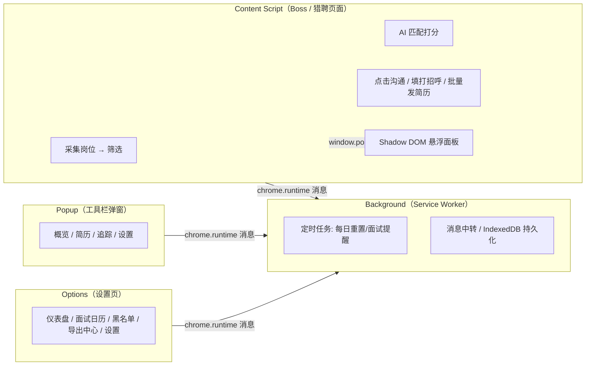
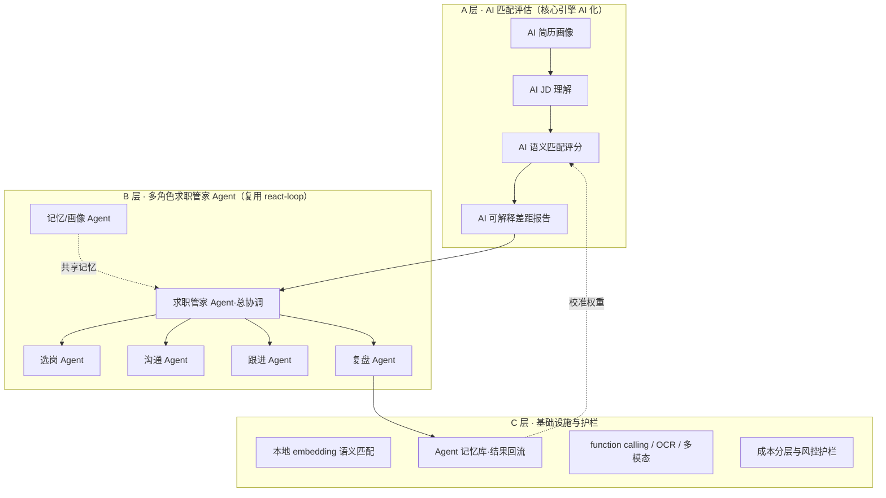
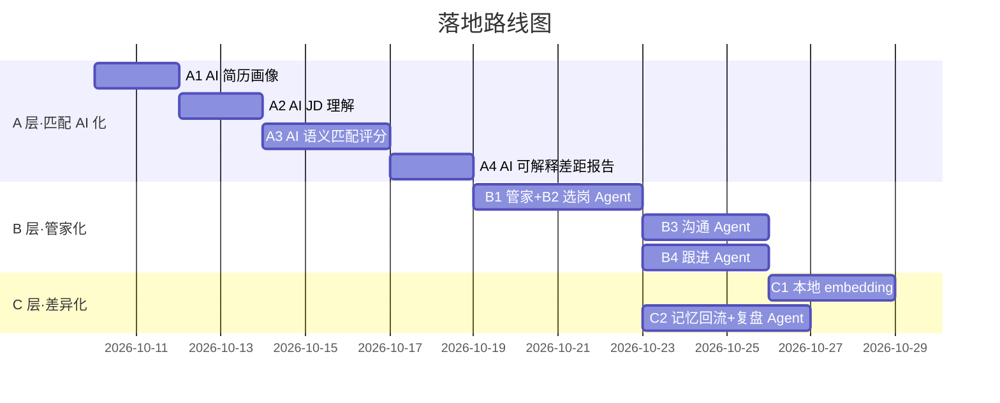

# 求职投递助手 AI 化诊断与开发规划

> 项目：智能求职助手（qiuzhizhushou）· Chrome 扩展（Manifest V3）
> 本地仓库：`/Users/pc/zhipinzhushou` ｜ 远端：`git@github.com:cunzailv/qiuzhizhushou.git`（main 同步，HEAD `fa2546ba`）
> 版本：v1.0.0（2026-07-27）｜ 文档日期：2026-10-10
> 定位：从「规则打分工具」升级为「AI 求职管家」

---

## 一、项目现状（代码级盘点）

### 1.1 产品与技术栈

| 项 | 内容 |
|---|---|
| 产品 | Boss直聘 + 猎聘的 AI 求职自动化 Chrome 扩展（求职者端） |
| 框架 | React 18 + TypeScript 5.6 + Vite 5 + @crxjs/vite-plugin |
| 样式 | Tailwind CSS 3 + tailwindcss-animate |
| 存储 | Dexie (IndexedDB) + chrome.storage.local 双写 |
| AI | OpenAI / DeepSeek / Qwen / GLM-4 / Kimi 等 12 种模型预设；本地规则匹配 + 远程 LLM 匹配 |
| 测试 | Vitest（单测）+ Playwright（E2E） |

### 1.2 四上下文架构



### 1.3 核心链路与已有功能

```
平台适配（boss ✅ / 猎聘 [待校准]）→ 解析 JobCard → 多维筛选
→ 匹配打分（本地 + 远程 AI）→ 防封（随机延迟/人类行为/风险检测）
→ 投递 → 追踪（投递记录/面试日历/黑名单/CSV·Excel 导出）
```

已有功能：简历 PDF/DOCX 解析、多维筛选、一键批量投递、本地+远程 AI 匹配、悬浮面板（拖拽/视口安全）、聊天页批量发简历（`sendResumesOnChatPage`）、面试日历浏览器通知、黑名单管理、CSV/Excel 导出。

### 1.4 已有 AI 基础（关键）

1. **远程 AI 匹配**：`remote-matcher.ts`（LLM 输出 score/skillMatch/skillGap/recommendation）+ `job-match-analyzer.ts`（流式 + 四步推理 + 结构化 JSON）。
2. **网页自动化 ReAct Agent 框架**（`src/shared/agent/`）：`react-loop.ts`（采集页面 → 问 AI → 执行 → 验证，最多 5 次）+ `action-executor.ts`（点击/输入，含 React 合成事件绕过）+ `page-observer.ts` + `skill-memory.ts`（选择器签名技能缓存），当前仅覆盖 `open_detail / click_chat / send_greeting` 三类机械目标。

**现状定性**：AI 目前只做两件事——① 作为本地规则打分的可选替代；② 点按钮时的动作推理。**匹配评估的语义层、投递策略、跟进、复盘，均无 AI/智能体介入** —— 这是本次规划的最大挖掘空间。

---

## 二、简版匹配打分诊断（代码级）

**核心结论：当前分数 ≈「技能关键词重合率 + 简历自身水平分」，不是「岗位匹配度」。**

### 2.1 数据输入层

| 问题 | 代码证据 | 影响 |
|---|---|---|
| 简历年限恒为 0 | `structure-extractor.ts`：`yearsOfExperience: 0`，无起止日期解析 | 匹配器拿不到真实经验 |
| 项目经历恒为空 | 同上：`projects: []` | 项目成果无法参与匹配 |
| 学历只取第一条 | `extractEducation` 只处理首个匹配 | 本科+硕士等多段教育丢失 |
| JD 硬性条件无结构化 | `types/job.ts` 的 `JobCard` 无 requirements 字段 | 学历/年限/城市/薪资无法做硬门槛判定 |
| 列表页 JD 文本先天不足 | 2026-07-26 设计文档自认：多数卡片无完整描述 | 评分退化到依赖标题+标签 |

### 2.2 评分算法层（`local-matcher.ts` 逐项）

| 现有规则 | 问题 |
|---|---|
| 技能重合 ≤50 分 | 只认固定词典（`skills-dict.ts` 12 类约 130 词），词典外技能全部盲区 |
| "必需技能数" | 不区分 must-have / nice-to-have，凡出现即视为必需 |
| 文本相似度 ≤30 分 | 中文双字 shingle 的 Jaccard，任意两字重合即加分，噪音大且与技能分重复 |
| 方向对齐 ≤30 分 | 固定 `ROLE_KEYWORDS`，新岗位名覆盖不全 |
| 经验加分 ≤10 | 按工作段数 ×3（`length * 3`），**非年数**；且是简历自身分 |
| 学历/技能数加分 | 有本科 +3、技能多 +5 —— 投任何岗位都有固定底分，**分数虚高** |
| 无硬门槛 | 学历不够、年限不够、城市不符，照样可 60+ 分被推荐 |

### 2.3 行动层与闭环层

- 缺口清单（skillGap）只来自固定词典、最多 5 条；本地模式没有"怎么改简历"的具体建议（远程 analyzer 有 improvementSuggestions，但未打通本地链路）。
- 批量投递按 ≥60 过滤，没有按分数排序择优，也没有"分数 × 薪资 × 回复概率"的优先级。
- 投递结果（进面/Offer）**不回流**，匹配模型永远无法校准。
- 已知工程遗留：猎聘选择器 [待校准]；E2E 4 个预存失败（`expect.poll().toMatch` 兼容、toast 时序、mock close 按钮）；单测仅覆盖 local-matcher。

---

## 三、AI 化蓝图：从「打分工具」到「AI 求职管家」

**长期愿景**：AI 求职管家 = 理解简历画像 → 主动找岗选岗 → 判断值不值得投 → 定制简历与话术 → 半自动投递跟进 → 复盘迭代，且越用越懂你。



### 3.1 A 层 — AI 深度介入匹配评估（直击简版短板）

| # | 功能 | 落地要点 | 衔接现有代码 |
|---|---|---|---|
| A1 | **AI 简历画像** | 规则解析 + AI 校正补全：真实年限、项目成果量化、技能分级、一句话画像 | 扩展 `structure-extractor`，接 `resume-analyzer` |
| A2 | **AI JD 理解** | 职责/硬性要求/加分项/薪资区间结构化，技能分 must-have / nice-to-have | 扩展 `types/job.ts` + `local-matcher` 前置 |
| A3 | **AI 语义匹配评分** | embedding 语义相似度（本地离线可选）+ LLM 精评；本地规则只做初筛与硬门槛 | 新增 `semantic-matcher`，升级 `remote-matcher` |
| A4 | **AI 可解释差距报告** | 逐维度分数拆解 + 每条差距给"简历改写点/学习路径"，联动定制简历要点 | 升级 `job-match-analyzer` |

### 3.2 B 层 — AI 智能体介入求职流程

| # | 角色 | 职责 | 说明 |
|---|---|---|---|
| B1 | **求职管家 Agent**（总协调） | 理解用户目标 → 制定投递策略（配额分配、岗位/平台优先级）→ 调度子 Agent → 日报 | 全流程大脑 |
| B2 | **选岗 Agent** | 综合"匹配度 × 薪资 × 公司质量 × 回复概率 × 用户偏好"判断值不值得投，识别错位岗位并解释 | 替代"60 分一刀切" |
| B3 | **沟通 Agent** | 按公司/BOSS/岗位生成个性化打招呼；聊天页自动应答（薪资期望/到岗时间等）；增强批量发简历 | 复用升级 `react-loop` + `skill-memory` |
| B4 | **跟进 Agent** | 定时扫描投递状态，N 天未回复 → 生成跟进话术（建议或半自动发送）；联动面试日历 | 挂载 background alarm |
| B5 | **复盘 Agent** | 周/季自动复盘：投递→沟通→面试→Offer 漏斗、命中率、策略建议 | Options Dashboard + Recharts |
| B6 | **记忆/画像 Agent** | 沉淀公司画像、HR 偏好、结果标签，作为共享记忆供所有 Agent 调用 | 新增 Dexie 表 |

### 3.3 C 层 — AI 基础设施与护栏

| # | 项 | 说明 |
|---|---|---|
| C1 | 本地语义匹配 | transformers.js 离线 embedding（省钱、快、简历隐私不出本地），LLM 只做精评与决策 |
| C2 | Agent 记忆库 | 投递结果回流 → 评分权重校准 + 用户画像更新（解决"越用越不准"） |
| C3 | 多模型/多模态增强 | function calling、流式、简历扫描件 OCR |
| C4 | 成本与风控护栏 | 分层调用（本地初筛 → AI 精评 TOP-N → Agent 决策）；每日 AI 预算上限；**所有自动动作保持"建议+确认"** |

---

## 四、落地路线图与实施计划



### 4.1 第一阶段（A 层）开发明细

| 步骤 | 开发内容 | 涉及文件 | 验收标准 |
|---|---|---|---|
| A1 | AI 简历画像：规则 + AI 校正（年限推断、成果量化、技能分级、一句话画像） | 改 `src/shared/parser/structure-extractor.ts`；新增 `src/shared/ai/resume-enricher.ts` | 单测覆盖年限推断/成果提取；简历解析字段不再恒空 |
| A2 | AI JD 理解：职责/硬性/加分/薪资结构化，技能分级 | 改 `src/shared/types/job.ts`；新增 `src/shared/ai/jd-analyzer.ts` | 单测覆盖硬性/加分项分类；结构化输出稳定 JSON |
| A3 | AI 语义匹配：规则降为初筛+硬门槛；LLM 语义评分 + 分维度得分（本地 embedding 放第二阶段） | 改 `local-matcher.ts`（初筛+硬门槛）；升级 `remote-matcher.ts`；新增 `semantic-matcher.ts` | 匹配/不匹配岗位分差 ≥20（沿用现有测试口径）；硬门槛拦截生效 |
| A4 | AI 可解释差距报告：维度拆解 + 改写建议，联动定制简历要点 | 升级 `job-match-analyzer.ts`；扩展 `MatchResult` | 报告含维度分+行动建议；AI JSON 解析容错 |

**开发规范**：TypeScript 严格类型；每步先写失败单测（沿用 `tests/local-matcher.test.ts` 风格）→ 实现 → `npm run build` 通过 → 相关测试绿；E2E 只要求不新增失败；每步完成 git 提交。

**明确不做**：不放开自动投递（保持半自动确认）；不引入新框架；第一版不接本地 embedding。

### 4.2 后续阶段（另行确认后启动）

- 第二阶段（B 层）：B1 管家 → B2 选岗 → B3 沟通 → B4 跟进（复用升级 `react-loop`）。
- 第三阶段（C 层）：本地 embedding、记忆回流、复盘 Agent、成本护栏。

---

## 五、风险与护栏

1. **Agent 自动投递/发消息 = 半自动**：AI 给建议与草稿，人确认后执行——兼顾效率与 Boss 风控、平台条款、账号安全。
2. **硬门槛不由 AI 决定**：学历/年限/城市等硬性判定仍走规则，AI 只做语义与策略层，防止幻觉误判。
3. **每次 AI 决策留痕**（thinking / 依据 / 结果），可复盘、可追溯，建立用户信任。
4. **成本分层**：本地初筛 → AI 精评 TOP-N → Agent 决策，控制 token 消耗与批量延迟。

---

## 附录：信息来源

- GitHub 仓库：https://github.com/cunzailv/qiuzhizhushou（main `fa2546ba`）
- 本地代码：`/Users/pc/zhipinzhushou/src/`（local-matcher / structure-extractor / skills-dict / remote-matcher / job-match-analyzer / agent / types 等）
- 设计文档：`docs/superpowers/specs/2026-07-26-scoring-and-floating-panel-design.md`
- 开发计划：`.codebuddy/plans/`（boss-zhpin-auto-apply / unlimited-apply / fix-scan-ui-export）
- 项目记忆：`~/.claude/projects/-Users-pc-zhipinzhushou/memory/`（project-overview / next-phase-plan / test-status）
