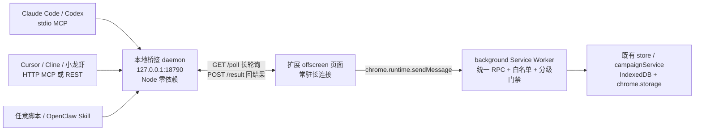

# 外部 AI 接入 · 一条龙使用指南

> 让 **Claude Code / Codex / Cursor / Cline / OpenClaw（小龙虾）bot / 任意 MCP 客户端或脚本**
> 直接读写「智能求职助手」里的求职数据，并控制 AIbot 投递流水线。
> 版本：扩展 v1.2.0（含 G 层外部 AI 接入）｜新增于 2026-11-06

---

## 一、先说清楚：之前有没有？

**之前没有。** 原项目是一个纯浏览器 Chrome 扩展（Manifest V3），没有 `externally_connectable`、没有 Native Messaging、没有任何监听端口，外部进程没有任何官方入口能调用它。

内部有两个「bot」，但都只在扩展内部闭环：

| 内部 bot | 能做什么 | 外部 AI 能不能用 |
|---|---|---|
| **AIbot 流水线**（popup 的 `pipeline` Tab → `CampaignPanel` → `campaignService`） | 全自动开跑 / 暂停 / 恢复 / 终止、平台配额、采集岗位、行为日志 | ❌ 只能人点 UI |
| **对话式管家**（`DISPATCH_BUTLER_CHAT` → 8 个 Action） | 改画像、改节奏、导出 CSV、查统计、加黑名单、清队列 | ❌ 只能页面浮窗里聊天 |

而且这两个 bot **都没有覆盖**简历列表/切换、黑名单查询与删除、面试日历、日报与进化提案、错误日志、自愈待修清单、设置读取等能力。

**本次新增**：一条统一的外部 RPC 通道 + 47 个工具，把项目几乎所有功能都暴露出来，并做成 MCP Server，让别人的 AI 也能用。

---

## 二、架构：为什么是「反向长轮询」

MV3 扩展**不能监听端口**，Service Worker 又会被休眠。所以不能让外部 AI 主动连扩展，只能让扩展主动来取命令：



关键点：

- **只监听 127.0.0.1**，不开公网端口、不上传任何数据。
- 扩展侧只需新增 `offscreen` 权限 + `http://127.0.0.1/*` 的 host permission，不需要固定扩展 ID，也不需要 Native Messaging。
- offscreen 页面由 background 在启动 / 开启开关时创建，并用 1 分钟 alarm 保活；被浏览器回收后会自动重建。
- 命令在 daemon 里排队，扩展 90 秒未回应会自动重投一次，不会静默丢单。

---

## 三、一条龙安装

### 全新机器（macOS / Linux）

```bash
# 方式 A：直接运行仓库脚本
git clone https://github.com/cunzailv/qiuzhizhushou.git
cd qiuzhizhushou
./scripts/install.sh

# 方式 B：用 curl 直接跑（脚本会自动 clone 到 ~/qiuzhizhushou）
curl -fsSL https://raw.githubusercontent.com/cunzailv/qiuzhizhushou/main/scripts/install.sh | bash
```

GitHub 不通时换镜像：

```bash
./scripts/install.sh --repo <你的镜像地址> --dir ~/qzzs
```

### Windows

```bat
git clone https://github.com/cunzailv/qiuzhizhushou.git
cd qiuzhizhushou
scripts\install.cmd
```

### 脚本自动做了什么

| 步骤 | 动作 |
|---|---|
| 1 | 检查 Node.js ≥ 18 |
| 2 | `npm install` + 类型检查 + `vite build` 生成 `dist/`（已存在则跳过，不会反复清空目录） |
| 3 | 生成 `~/.qiuzhizhushou/bridge.json`（随机 48 位 token，文件权限 600） |
| 4 | 自动写入 Claude Code / Codex / Cursor 的 MCP 配置（**先备份**，同名已存在则跳过，`--force` 才覆盖） |
| 5 | 生成通用 `mcp-config.json` 与 `openclaw-bridge.json` |
| 6 | 后台启动常驻 daemon |
| 7 | 跑一遍 `doctor` 体检 |

### 只剩两步必须手工（浏览器沙箱限制，任何工具都绕不过）

1. `chrome://extensions` → 开发者模式 → **加载已解压的扩展程序** → 选项目里的 `dist/`。
2. 打开扩展 **设置 → 外部 AI 接入** → 打开总开关 → 点 **「连接本地桥接」**（自动一次性配对，不用复制 token）。

状态变绿后，重启一下你的 AI 客户端让它加载新 MCP 配置，就完成了。

> 需要自定义端口：`./scripts/install.sh --port 19000`，然后在设置页把地址改成 `http://127.0.0.1:19000`。

### 常用运维命令

```bash
node bridge/bin/cli.mjs doctor           # 逐项体检 + 修复建议
node bridge/bin/cli.mjs status           # 服务状态
node bridge/bin/cli.mjs restart          # 重启
node bridge/bin/cli.mjs token            # 查看 token
node bridge/bin/cli.mjs token reset      # 重置 token（随后 integrations --force）
node bridge/bin/cli.mjs pair-reset       # 允许扩展重新配对
node bridge/bin/cli.mjs integrations --force
./scripts/uninstall.sh                   # 停止服务（不删除任何数据或配置）
```

日志：`~/.qiuzhizhushou/bridge.log`

---

## 四、各 AI 客户端怎么接

### Claude Code / Cursor / Cline（stdio MCP）

安装脚本已自动写入。手工配置片段：

```json
{
  "mcpServers": {
    "qiuzhizhushou": {
      "command": "node",
      "args": ["/绝对路径/qiuzhizhushou/bridge/src/mcp-stdio.mjs"],
      "env": {
        "QZZS_BRIDGE_URL": "http://127.0.0.1:18790",
        "QZZS_BRIDGE_TOKEN": "<bridge.json 里的 token>"
      }
    }
  }
}
```

### Codex CLI

`~/.codex/config.toml`：

```toml
[mcp_servers.qiuzhizhushou]
command = "node"
args = ["/绝对路径/qiuzhizhushou/bridge/src/mcp-stdio.mjs"]
env = { QZZS_BRIDGE_URL = "http://127.0.0.1:18790", QZZS_BRIDGE_TOKEN = "<token>" }
```

### OpenClaw / 小龙虾 bot

两种都支持，按你的小龙虾能力选一种：

- **支持 MCP**：填 HTTP MCP `http://127.0.0.1:18790/mcp`，Header `Authorization: Bearer <token>`。
- **只支持 HTTP 工具 / Skill**：把 [`bridge/integrations/openclaw-skill.md`](../bridge/integrations/openclaw-skill.md) 放进小龙虾的 skills 目录，配置见 `~/.qiuzhizhushou/openclaw-bridge.json`。核心就一个调用：

```bash
curl -s -X POST http://127.0.0.1:18790/rpc \
  -H "Content-Type: application/json" \
  -H "Authorization: Bearer $TOKEN" \
  -d '{"tool":"get_dashboard_stats","args":{}}'
```

> 端口别混：`18789` 常是小龙虾 Gateway 自己，`18790` 是本桥接服务。

### 任意脚本 / 其它 AI

- `GET /tools` 拿实时工具清单（含 JSON Schema 与风险分级）
- `POST /rpc` 调工具
- `GET /events` 订阅 SSE 事件（`hello` / `command` / `result` / `paired`）
- `POST /mcp` 是标准 Streamable HTTP MCP（JSON-RPC 2.0）

---

## 五、工具清单与三级权限

共 **47 个工具**（只读 24 / 写入 15 / 危险 8），完整清单在扩展「设置 → 外部 AI 接入」可展开查看，也可 `GET /tools` 实时获取。权威定义在 `src/shared/bridge/tools.ts`。

| 级别 | 代表性工具 | 默认 |
|---|---|---|
| **只读 read** | `get_status`、`get_campaign_stats`、`get_dashboard_stats`、`list_applications`、`list_resumes`、`get_default_resume`、`list_blacklist`、`list_interviews`、`get_daily_report`、`list_errors`、`get_fix_suggestions`、`export_applications_csv`、`export_blacklist_csv`、`get_page_info` | 开启总开关后可用 |
| **写入 write** | `set_platform_quota`、`set_platform_enabled`、`update_assistant_state`、`generate_daily_report`、`dispatch_butler_chat`、`add_blacklist`、`remove_blacklist`、`add_interview`、`delete_interview`、`accept_evolution_proposal` | 默认允许，可单独关闭 |
| **危险 dangerous** | `start_campaign`、`pause_campaign`、`resume_campaign`、`stop_campaign`、`trigger_auto_collect`、`clear_pending_tasks`、`clear_all_applications`、`run_butler_scan` | **默认拒绝**；需在设置页显式授权，且每次调用带 `confirm: true` |

安全设计：

- **fail-closed**：总开关默认关，危险开关默认关，未开启时任何调用（含只读）都被拒。
- **脱敏**：`get_settings` 永不返回 `apiKey` / `token` / webhook URL 等敏感值。
- **一次性配对**：`/pair` 只成功一次，token 不会暴露在 `/health`；重新配对需终端执行 `pair-reset`。
- **地址白名单**：扩展只接受 `127.0.0.1` / `localhost` 的桥接地址，防止把 token 发到远端。
- **消息来源校验**：background 只接受扩展自身上下文发来的 RPC。
- **只复用既有链路**：`stop_campaign` 走的就是 UI「终止」同一个 `shutdownAssistant()`，不会出现「UI 停了后台还在跑」。

---

## 六、REST API 速查

所有接口除 `/health`、`/pair` 外都需要 `Authorization: Bearer <token>`（也支持 `?token=` / `X-QZZS-Token`）。

| 方法 | 路径 | 说明 |
|---|---|---|
| GET | `/health` | 服务状态、扩展是否连接、工具数、队列长度（不含 token） |
| POST | `/pair` | 一次性配对，返回 token（仅首次成功） |
| POST | `/hello` | 扩展心跳 + 上报工具清单 |
| GET | `/poll?timeout=20` | 扩展长轮询取一条命令，无命令返回 `{command:null}` |
| POST | `/result` | 扩展回传 `{id, ok, data, error}` |
| POST | `/rpc` | 同步调用 `{tool, args}`，等待扩展执行完返回结果 |
| GET | `/tools` | 实时工具清单 |
| GET | `/events` | SSE 事件流 |
| POST | `/mcp` | Streamable HTTP MCP（initialize / tools/list / tools/call / ping） |

---

## 七、排障

| 现象 | 原因 / 处理 |
|---|---|
| `connection refused` | daemon 没起：`node bridge/bin/cli.mjs start` |
| `401 token 无效` | 重新取 `~/.qiuzhizhushou/bridge.json`；或 `token reset` + `integrations --force` |
| `409 已完成过一次性配对` | `node bridge/bin/cli.mjs pair-reset`，再回扩展点「连接本地桥接」 |
| `503 扩展未连接` | Chrome 加载 `dist/`；设置页开启总开关；确认 offscreen 页面已创建 |
| 设置页一直「连接中」 | 看 `bridge.log`；确认 manifest 里有 `offscreen` 权限且重新构建过 `dist/` |
| 工具列表只有 1 个 | 扩展还没上报清单，完成配对并等一次心跳（≤30 秒） |
| 危险工具被拒 | 设置页打开「允许外部 AI 执行危险动作」，调用时带 `confirm: true` |
| 全量体检 | `node bridge/bin/cli.mjs doctor` |

---

## 八、已知边界（如实说明）

- **浏览器沙箱无法完全免手工**：Chrome 不允许脚本替用户「加载已解压的扩展」，也不允许外部进程写 `chrome.storage`。所以「加载 dist」和「点一次连接」这两步必须人工完成，其余全自动。
- `chrome://extensions` 加载的是 `dist/`，源码改动后必须重新构建，否则设置页看不到新卡片。
- offscreen 页面依赖 Chrome 109+ 的 `chrome.offscreen`；不支持的浏览器会拿不到连接（不影响扩展其它功能）。
- 浏览器 E2E 仍是「真实 Chromium + 模拟页面」，猎聘等平台真实站点选择器未校准；外部 AI 触发真实投递前请自行确认平台规则。
- 桥接服务是本机单用户设计，没有多用户隔离、没有 TLS；不要把它绑定到 `0.0.0.0`。
- 所有数据仍只存在本机浏览器（IndexedDB / chrome.storage），daemon 只做命令转发，不持久化任何求职数据。
